# ChemClaw v0.3.0

**简体中文** | [English](README.en.md) | [日本語](README.ja.md) | [한국어](README.ko.md) | [Русский](README.ru.md) | [Français](README.fr.md) | [العربية](README.ar.md) | [Español](README.es.md) | [Português](README.pt.md)

**做化工现货贸易，最重要的是找到真正有采购需求的客户、供货能力可靠的供应商，以及有来源、有明确报价口径的市场价格。**

- 卖重质纯碱，怎样找到即将投产、可能新增用碱需求的玻璃厂？
- 采购环氧丙烷，怎样分清生产厂家、代理商和现货渠道，再核对含税送到价？
- 做进口乙二醇，怎样找到海外真实生产商，算清进口到厂成本？
- 做甲醇期现研究，又怎样把现货、盘面、库存和检修放在同一份可信的数据底稿里？

ChemClaw 就是为解决这些问题而生的，是一个**面向化工现货贸易与能源化工研究的桌面智能体**。它内置了 **50 位专家、15 个协作群、108 项化工领域技能**，像在微信里指挥一支专家团队，你发一句话，群主自动规划，还能 @ 群内专家协作。它查得到化工专属数据、核得到原始证据、在聊天里直接出图，最后交付带出处的 Excel、研究报告、PPT、Word 或交互网页。

## ChemClaw 和普通 AI、通用 Agent 有什么区别？

| 能力维度 | 普通网页版 AI | 需要自配置的通用 Agent | **ChemClaw 已经准备好的** |
| --- | --- | --- | --- |
| **化工数据** | 搜不到化工行业的结构化数据 | 要自己接数据源、写查询 | **[芯化和云数据中台](https://mcp.chem-cloud.cn/)** 直接可查：化合物 CAS/档案/安全资料、企业工商/股权/专利/招投标/客户画像、授权范围内询报价/订单/库存/回款、市场门店与价格趋势 |
| **找客户** | 帮搜企业，还得你逐个说明用途和筛选标准 | 能组装数据源，产业资料要自己配 | 先查数据中台上下游与企业候选，再查**环评原辅材料表、工厂官网、扩产公示**，按"真实用料证据"出客户名单 |
| **找供应商** | 能列候选，生产身份与供货能力要另查 | 可连企业信息工具 | **分厂家/渠道两张表**，核对生产基地、牌号、资质，列清库存/COA/交期/账期待询 |
| **查现货价格** | 多平台日期、地区、口径要自己对齐 | 可接行情工具，需自定比价规则 | 先查数据中台价格趋势，再核专业行情，分清品级/税费/出厂送到，**不拿期货价冒充现货** |
| **做外贸** | 能翻译和搜索，贸易关系仍要确认 | 需自设计国别核验与成本流程 | 目标国市场 + 海外生产商 + 公开贸易统计 + 公司官网，再做英文询盘与 FOB/CFR/CIF 测算 |
| **期现/量化** | 能写综述或解释方法 | 接工具后研究规范要自己定 | **现有技能**：季节性、领先滞后、事件研究、规则回测，关注真实挂牌合约、换月、数据发布时间与样本外 |

## 两个入口：化工数据 + 便宜的模型

- **芯化和云数据中台：让 AI 查得到化工行业真正有用的数据。** 化合物与安全资料、企业工商与客户画像、授权内的交易业务数据、市场与价格趋势，都在这一个入口里。
- **APIHub 模型服务：给 ChemClaw 配一个经济实用的 AI 模型。** 官网提供 ¥0.01 尝鲜套餐和按天/周/月/季选择的无限量套餐。

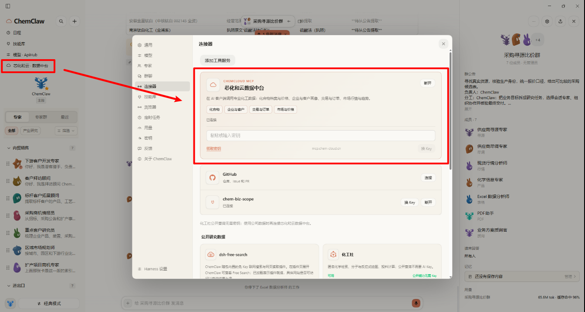

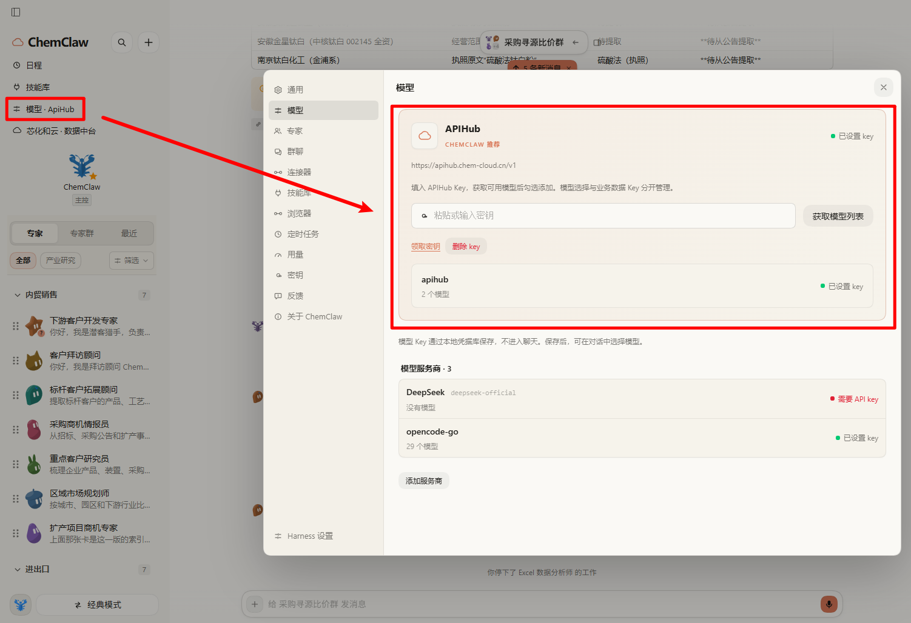

芯化和云建设的《面向化工产业智能体的行业专识高质量数据集》已入选 **2026 年上海市行业高质量数据集典型案例**，并在 **2026 全球数商大会**发布现场展示。[上海市数据局公示名单](https://dt.sheitc.sh.gov.cn/cms/slddt/3123.jhtml)

## 六个真实任务，六份真实交付

下面六个示例都来自真实任务，从"一句话需求"到"可交付文件"的完整链路，每份成果都带来源、口径和待核实项。

### ① 内贸销售 · 找下游客户（重质纯碱 → 华东光伏玻璃厂）

> 找到未来 6–12 个月可能新增用碱量的华东光伏玻璃厂，重点江苏、安徽、浙江。

**交付**：可筛选 Excel（企业/基地/项目/建设阶段/预计节点/用碱证据/来源/置信度）+ 项目时间轴 + 前 10 家拜访建议。没有环评原辅材料表用量证据的只列"待核实"，**不把设计产能换算成订单**。

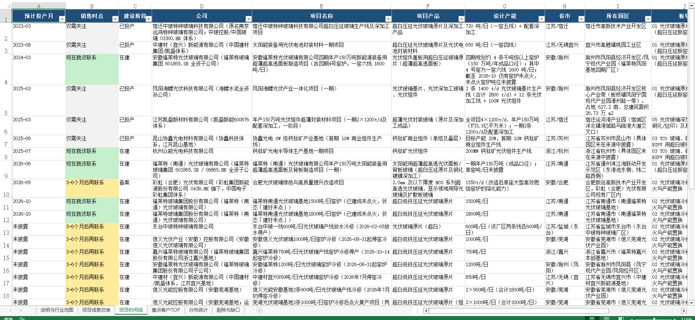

### ② 内贸采购 · 供应商比价（金红石型钛白粉）

> 采购 300 吨金红石型钛白粉送到安徽芜湖，同时比较工厂直供与现货经销渠道。

**交付**：厂家/渠道分列的 Excel 询价底稿（牌号/生产授权证据/规格/价格快照/待询盘项）。由"采购寻源比价群"协调供应商尽调、Excel、质询官多专家协作；**实时库存、含税送到价、COA、交期拿不到就标"待询盘"**。

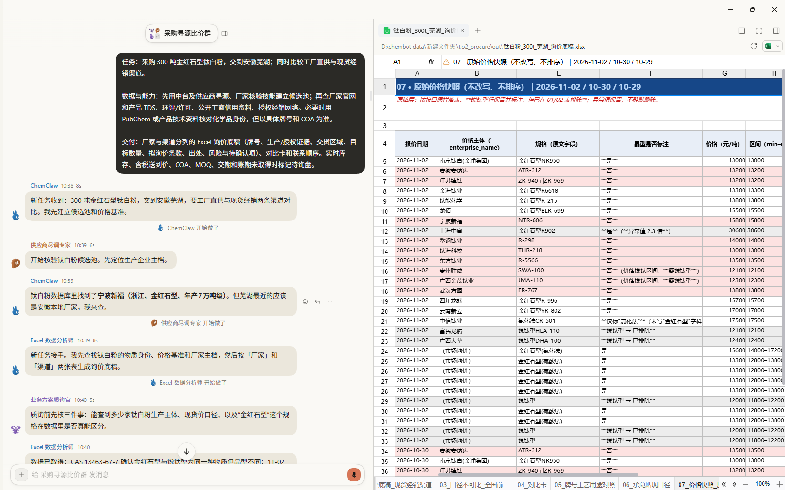

### ③ 外贸销售 · 海外买家开发（涂料溶剂 → 印尼）

> 开发印尼涂料及油墨生产企业，并区分终端工厂、进口商、经销商。

**交付**：双语客户画像 + 带证据等级的 Excel 候选名单（本例 28 家候选、13 家 P1 首轮联系）+ 首封英文开发邮件。**国家进口量绝不写成某家公司的采购量，不编造私人联系方式。**

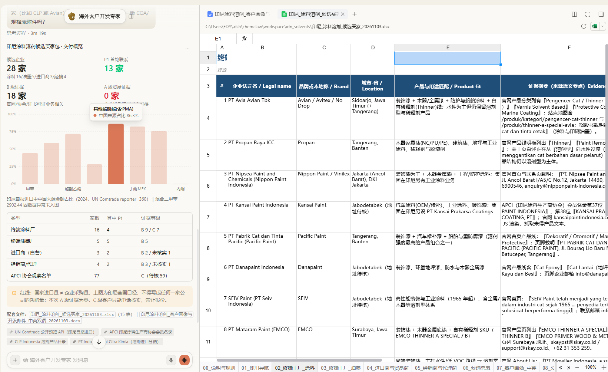

### ④ 外贸采购 · 海外生产商核验（乙二醇 → 华东进口）

> 从沙特、阿联酋筛出真正生产 MEG 的法人，而不是只有出口业务的中间商。

**交付**：供应商证据分级台账 + 英文 RFQ（品名/CAS/规格/数量/贸易术语）+ 可改参数的 Excel 到厂成本模型与敏感性表。**分辨生产法人、销售公司与贸易商，设计产能不当成当前可售量。**

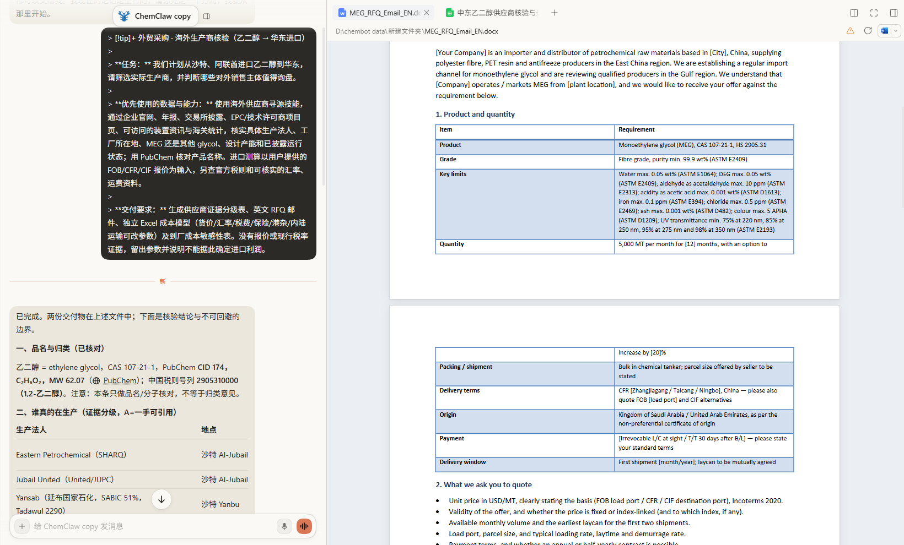

### ⑤ 期现研究 · 基差变化归因（甲醇现货 vs MA 期货）

> 研究最近一季度华东甲醇现货与 MA 期货基差为什么变化，供采购点价与库存管理讨论。

**交付**：聊天里直接出"现货+期货双线 / 独立基差 / 期限结构"三张联动图 + 指标卡，另附 Excel 底稿和产业研究 PPT。**注明合约、采价点、单位与口径，换月跳空单独处理。**

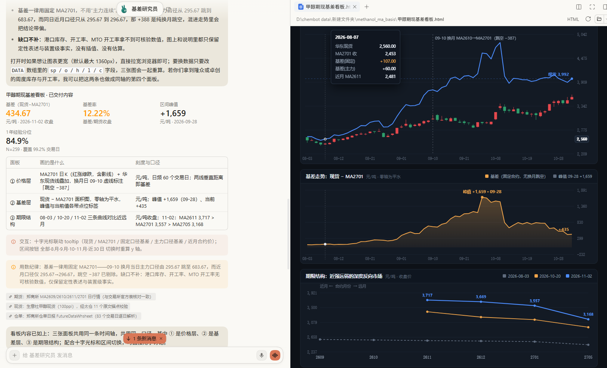

### ⑥ 量化研究 · 领先滞后检验（港口库存 vs MA 收益）

> 检验甲醇港口库存变化对后续 1–8 周 MA 期货收益是否有稳定领先关系。

**交付**：可复核 Excel（全 Lag、样本量、p/q 值、FDR 校正、分年结果）+ 交互研究网页。结论会直言"本样本内不存在稳定领先关系"，并**严格区分统计相关、因果与样本外预测能力**。

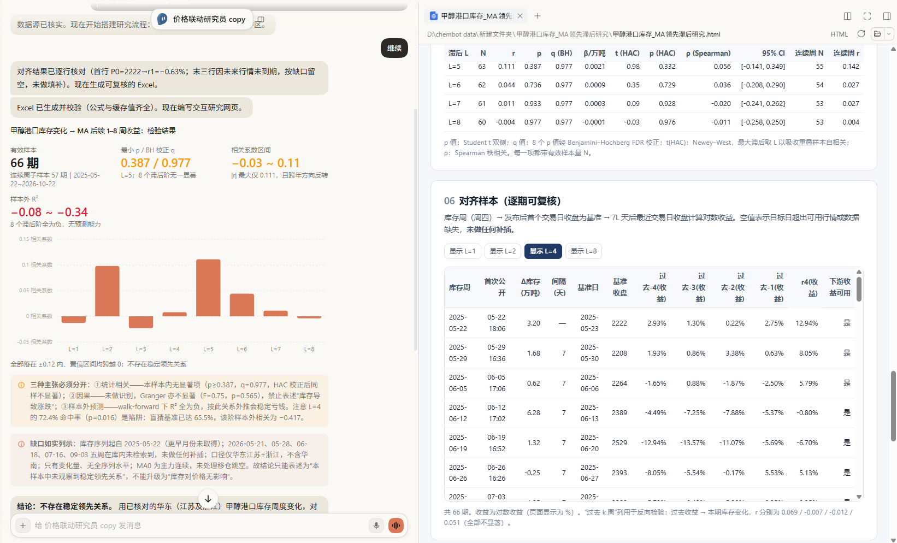

## 数据从哪来？先用行业数据缩小范围，再到原始来源核实

一个有用的结论通常要这样做出来：行业数据告诉你谁可能生产或使用，环评和项目文件告诉你工厂在哪、用多少，企业官网确认产品与基地，采购公告透露真实采购行为，专业行情判断报价是否合理。

| 数据入口 | 能查什么 | 用在哪 |
| --- | --- | --- |
| **芯化和云数据中台** | 化合物 CAS/档案/MSDS、企业工商/股权/专利/招投标/客户 360、授权内询报价/订单/库存/回款、市场门店与价格趋势 | 找客户/找供应商的企业底稿；价格趋势的优先入口 |
| **政府环评与项目公示** | 环评报告书/表、**原辅材料年用量**、排污许可、项目备案、园区与竣工验收 | 找真实用料证据、发现新建扩产、核实项目阶段 |
| **巨潮与交易所公告** | A 股年报/半年报、对外投资/扩产/技改、项目进展、招股书 | 追踪上市公司项目、产能与原料需求；**内置原始 PDF 读取，免密钥** |
| **招投标与采购平台** | 招标/中标、询价、供应商招募、政府采购、石化企业采购平台 | 直接找正在发生的采购机会 |
| **专业行情与资讯** | 隆众、卓创、金联创、百川、Mysteel、SMM、生意社、厂家调价函 | 现货报价交叉核对、装置检修、库存与开工 |
| **期货/股票/宏观** | 内置 AKShare 历史行情、交易所合约与仓单、CME/ICE、EIA/IEA/OPEC、统计局与海关 | 画 K 线、算基差月差、成本传导与供需研究 |
| **化学品身份** | PubChem、OPSIN、维基百科、化工社（公开免密钥） | 核对中英文名、CAS、结构，防范近似品混淆 |
| **海外企业与贸易** | UN Comtrade/WITS、各国工商登记、协会展会目录、Kompass/IndiaMART 等 B2B、可访问的 LinkedIn/X | 外贸找真实用料厂、进口商与海外生产装置 |

其中 **PubChem、OPSIN、维基百科、化工社、AKShare、巨潮公告、联网检索等公开能力无需额外配置密钥**：

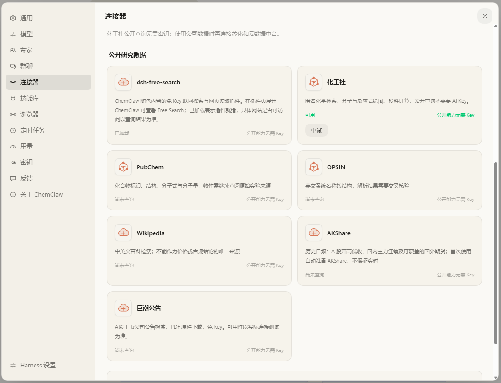

**它可以按任务选资料、把"发现"和"证据"分开：**

1. **缩小范围**：国内现货优先用数据中台；海外先明确产品/国家/买卖双方；期现先明确品种/合约/频率。
2. **多源核实**：查官网、环评、政府公示、许可平台、交易所公告、招投标、海外资料；不只引用搜索摘要。
3. **变成判断**：原辅料用量是否明确、项目是否投产、询盘主体是否真实、报价是否可比。
4. **产出文件**：客户表、询价表、扩产跟踪表、价格底稿、研究报告；**附来源与待核实项，能访问就引原文，访问不到就说明缺口。**

## 在聊天里直接看图，也能交付文件

数据查清后，若要把趋势讲清楚，ChemClaw 可以在对话里直接展示图表：现货折线、日 K 线、期现双线、**独立基差图**、项目时间轴、地区价差热力图、供应商比较图、产业链桑基图、可调参数的成本计算卡、散点与统计热力图……部分图表还能在界面内筛选、悬停看数据、改参数重算。

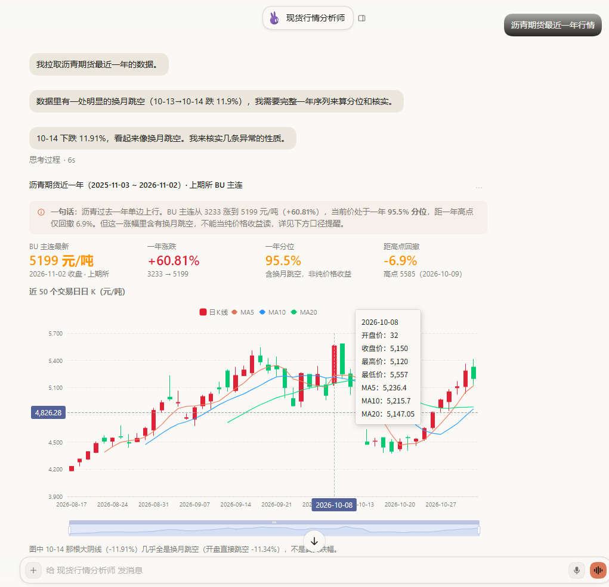

需要一份能转给同事、发给客户的文件时，一句话即可导出：

| 你想做什么 | 得到什么 |
| --- | --- |
| 展示行情、项目分布、专题研究 | **交互网页（HTML）**：图表+文字+筛选、悬停提示、来源链接 |
| 整理客户名单、供应商报价、产能数据 | **Excel（.xlsx）**：多工作表、可筛选、计算字段与来源说明 |
| 给客户或领导汇报 | **PowerPoint（.pptx）**：16:9，含结论、图表与来源 |
| 审合同、拜访纪要、尽调报告 | **Word（.docx）**：正式文档、表格、批注与修订 |
| 定稿、存档、打印 | **PDF（.pdf）** |

点击对话中的链接，即可从右侧栏直接打开产物：

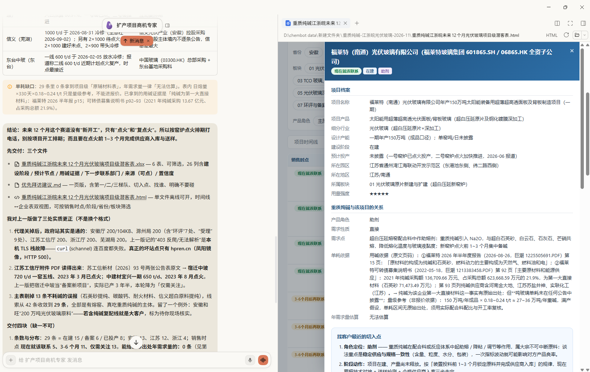

**已有的 Word、PPT、Excel 也能接着改**：审合同并带修订和批注、调整 PPT 页序与排版、盘点 Excel 隐藏 Sheet 与 `#REF!`/`#DIV/0!` 等公式错误——保留原件、另存副本、检查重算结果，不覆盖原稿。

## 帮你浏览网页，关键操作仍由你决定

很多信息要真正打开网站、翻页、填条件才能拿到。ChemClaw 可以读你正在看的网页、框选关键段落，也能自己开网页、搜索、点击、翻页。**碰到登录、验证码、付款、发布/删除等敏感操作，控制权交回给你接管。**

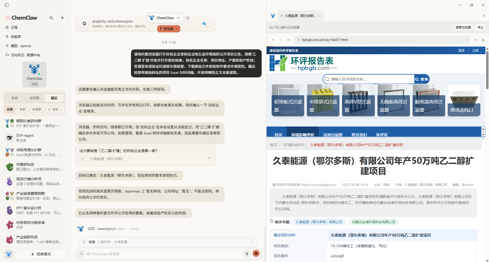

## 50 位专家、15 个群聊，怎么选？

**一件事优先找一位专家，也可直接交给主控 ChemClaw；涉及多个环节，再交给协作群。**

| 你的工作 | 可以先找谁 |
| --- | --- |
| 开发下游客户、寻找扩产商机 | 下游客户开发专家、标杆客户拓展顾问、扩产项目商机专家 |
| 找供应商、核实厂家、对比报价 | 供应商寻源专家、生产厂家核验员、采购比价分析师 |
| 海外买家、询盘核验、出口报价 | 海外客户开发专家、海外询盘顾问、出口报价单证专员 |
| 找海外生产商、比较进口成本 | 海外供应商尽调员、进口采购分析师 |
| 现货行情、行业供需、产能装置 | 现货行情分析师、供需研究员、产能装置研究员 |
| 基差、月差、内外盘与量化回测 | 基差研究员、月差研究员、内外盘价差分析师、策略回测研究员 |
| 汇报、底稿、复核 | PPT 演示设计师、Excel 数据分析师、业务方案质询官 |

<b>展开查看 50 位预设专家</b>

- **主控（1）**：ChemClaw（化工主控）。
- **内贸销售（7）**：下游客户开发专家、标杆客户拓展顾问、扩产项目商机专家、采购商机情报员、重点客户研究员、客户拜访顾问、区域市场规划师。
- **内贸采购（6）**：供应商寻源专家、生产厂家核验员、供应商尽调专家、资质风控专员、采购比价分析师、采购合同顾问。
- **外贸进出口（7）**：海外市场研究员、海外客户开发专家、海外询盘顾问、出口合规顾问（HS 编码）、出口报价单证专员、海外供应商尽调员、进口采购分析师。
- **产业研究（8）**：现货行情分析师、产业链研究员、供需研究员、产能装置研究员、成本利润分析师、产业资讯分析师、企业深度研究员、品种研究员。
- **期现量化（8）**：基差研究员、月差研究员、区域价差分析师、内外盘价差分析师、季节性研究员、价格联动研究员、事件研究员、策略回测研究员。
- **生产辅助（5）**：化学信息专家、工艺文献研究员、质量检验顾问（COA 核对）、物料能耗工程师、生产数据分析师。
- **交付与复核（8）**：HTML 报告设计师、图表地图设计师、PPT 演示设计师、Excel 数据分析师、文档与纪要专员、化工双语译审、业务方案质询官、任务规划与验收官。

**涉及多个环节，就交给协作群。** 例如开发华东顺酐下游客户，直接进「客户开发作战群」说需求，负责人会协调下游客户开发、扩产商机、企业核验与 Excel 岗位分工协作，并由业务方案质询官检查"生产证据和用料证据"是否被混淆，最后汇总一份去重的客户拜访 Excel。你也可以在群里 `@供应商寻源专家` 直接提要求。

<b>展开查看 15 个预设协作群</b>

客户开发作战群 · 客户拜访跟进群 · 采购寻源比价群 · 供应商尽调评审群 · 海外客户开拓群 · 出口报价单证群 · 进口采购研判群 · 行情供需研讨群 · 产业链装置跟踪群 · 期现价差研究群 · 策略回测讨论群 · 化学质量会诊群 · 工艺生产分析群 · 研报与演示协作群 · 业务方案评审群

### 更进一步：用 DSH 创造模式做自己的插件

ChemClaw 支持调用 DSH Agent 制作插件，甚至直接修改经典模式的侧边栏。下面是让它做一个"便利贴墙"插件的例子：

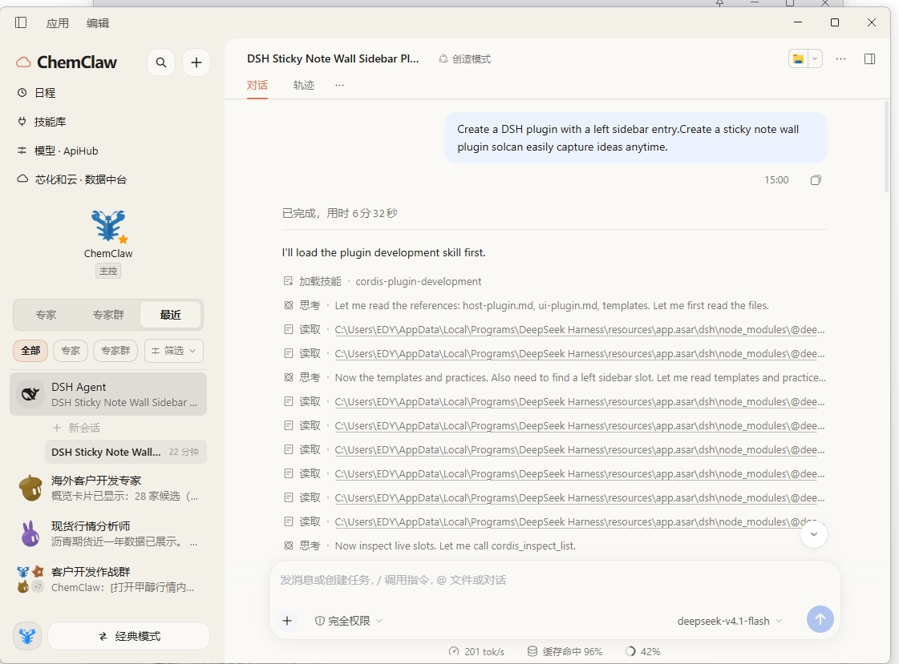

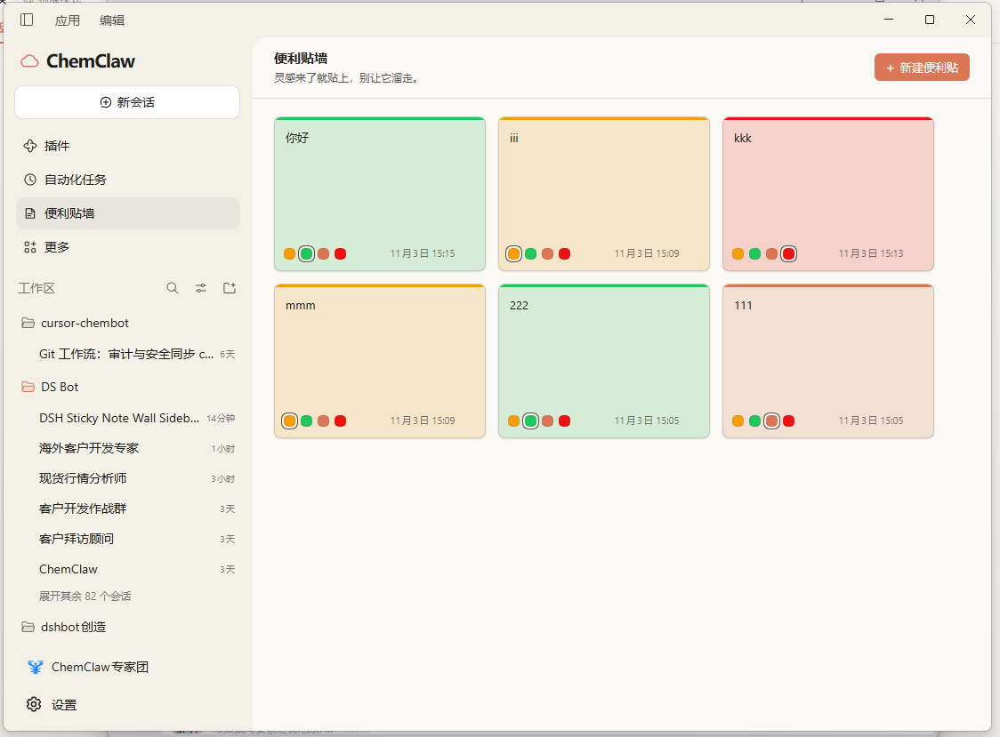

## 下载安装

**方式一：直接安装桌面版（推荐）**

1. 在 [ChemClaw Releases](https://github.com/zoeyzhang233666/chemclaw-bot/releases) 下载 **v0.3.0** 安装包并安装（Windows/macOS/Linux 文件以发布页为准）。
2. **配模型**：到 [APIHub](https://apihub.chem-cloud.cn/) 注册、取模型密钥，在 **设置 → 模型** 选预设的 APIHub，粘贴密钥并选可用模型。
3. **接数据（推荐）**：到 [芯化和云数据中台](https://mcp.chem-cloud.cn/) 申请数据密钥，在 **设置 → 连接器 → 芯化和云数据中台** 粘贴保存。连接地址已预设，无需懂 MCP。
4. 打开左侧的专家或协作群，直接提问即可。

**macOS 安装**：解压 ZIP 后，将 `ChemClaw.app` 拖到 Finder 的 **应用程序（Applications）** 文件夹，再从那里打开。首次从安装目录外打开时，应用会在团队启动前提示移入“应用程序”并重启；遇到同名应用时不会静默覆盖。如果已经从“下载”目录运行，请先完全退出 ChemClaw 再手动移动应用，运行期间保持应用位置不变。在 macOS Sequoia 15 中，安装后可在“启动台”搜索 `ChemClaw`。

| 需要配置 | 负责什么 | 密钥来源 | 填在哪里 |
| --- | --- | --- | --- |
| **APIHub 模型服务** | 理解问题、调用工具、写分析、做文件 | [APIHub](https://apihub.chem-cloud.cn/) | 左上角 APIHub |
| **芯化和云数据中台** | 查授权内的化工企业、产品、产业链、价格与商机数据 | [芯化和云数据中台](https://mcp.chem-cloud.cn/) | 左上角 芯化和云数据中台 |

> 巨潮公告、PubChem、OPSIN、化工社、可覆盖的 AKShare 历史行情、联网搜索等通常**无需额外密钥**，能否取到数据取决于网络和第三方来源。

**方式二：作为 DeepSeek Harness 插件安装**（已用 DSH 桌面版时）：确保本机有 Git，在 **插件 → 添加插件** 输入 `github:zoeyzhang233666/chemclaw-bot#v0.3.0&path:/chemclaw-bot`，按提示启用并重启。

## 使用前了解这些

- **它是辅助工具，不代替最终决策。** 交易、合同、产品质量、进出口合规等重要事项，仍需业务人员依据原始证据复核。
- **不代替交易系统或工厂控制系统。** ChemClaw 面向研究、寻源、分析与文件处理，不提供自动期货交易或生产设备控制。
- 项目基于 Fei2411 的 DS Bot 与 DeepSeek Harness 构建，相关声明见仓库 `NOTICE`。
