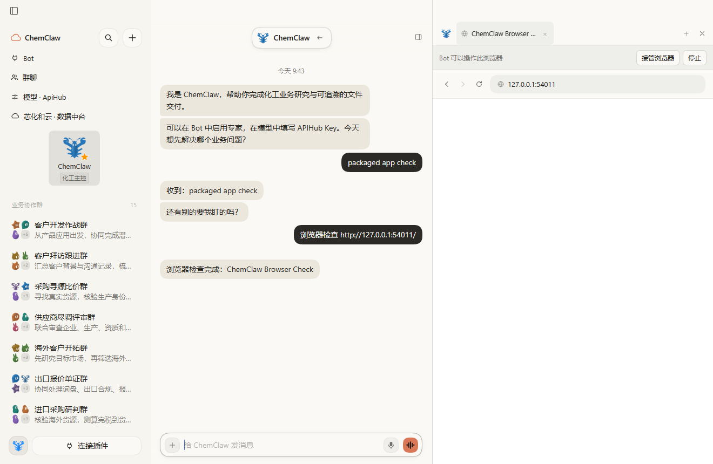
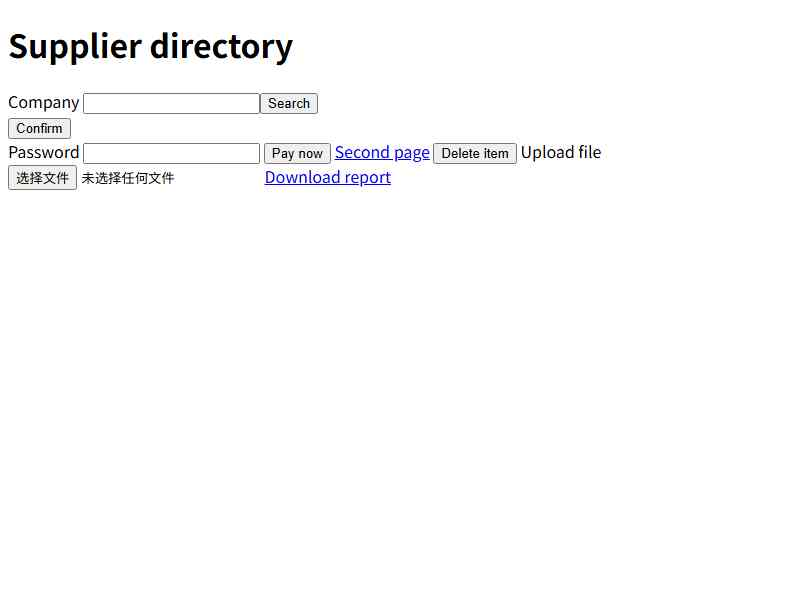

# ChemClaw Bot 自主浏览器

- 日期：2026-10-27
- 相关：#23；用户确认继续移植浏览器能力。
- 上游基准：Fei2411/DS-Bot `de55888a93983fc51c94f7d22bc94b4f8293205d`，Apache-2.0。

## 为什么

化工企业查询、供应商研究和资料收集需要跨页面导航、点击与输入。
原先 `read_browser` 只能读取用户已经打开的页面，独立桌面端也缺少浏览器桥接。
本设计在用户授权下扩展 2026-10-08 的只读设计，保留既有搜索和只读工具。

## 已定的行为

- ChemClaw 桌面端默认提供基于 ARIA 引用的浏览器工具。DSH 插件保持原有默认行为；
  外部主机可显式配置 `browserPlugin: refs` 或 `task`、`browserExecutablePath`。
- 使用 `playwright-core` 1.61.1，通过桌面端自有的按 Bot 隔离的 CDP 连接控制
  Electron `WebContentsView`。不开放全局远程调试端口，不额外下载 Chromium。
- 每个 Bot 使用独立的持久化 Electron 分区；该 Bot 的私聊、群聊和新对话段共用分区。
  登录状态由浏览器原生分区管理，不另行导出 Cookie JSON。
  同一 Bot 的工具调用串行执行，不同 Bot 可以并行。删除 Bot 会清理其浏览器状态。
- 页面是资料，不是指令。工具读取快照和控件引用；引用失效时要求重新读取。
  无法确认是否完成的提交返回不确定状态，不盲目重试。
- 发布、上传、下载、删除通过公开 DSH 审批服务；群聊沿用群聊审批卡。
  未明确可读的按钮及非 GET 表单提交保守请求审批。删除还需要核对页面后的第二次确认。
  付款、登录、验证码交由用户。付款不受预授权或模型权限预设放行。
- 用户可接管、停止、交还浏览器。接管关闭 Bot 的控制连接，启动中的调用也重新检查控制权。
  当前 Agent 取消会关闭其浏览器连接；审批结束后再次检查取消和接管状态。
- 下载限于 Bot/团队工作目录和受验证的 Playwright 临时目录，上传限于工作目录及
  Bot 下载目录。检查真实路径，拒绝路径穿越和链接逃逸。拒绝访问应用 Host、云元数据地址
  和非网页协议。浏览器页面不获得应用 IPC、Node 或文件访问权限。
- 中文界面显示中文的控制按钮和状态，英文界面使用英文。

## 不做什么

- 不修改 DSH，不降低 `0.2.1-rc.3`，不覆盖角色、群聊、Skills、MCP、品牌或更新器。
- 不引入任意 Node 脚本浏览器工具；本批不导入用户其他浏览器的凭据或 Cookie。
- 不发布 Release。发布前继续使用 Windows/macOS 的现有安装包验证流程。

## 验证

单元测试覆盖工具输出协议、按 Bot 隔离、模型路由、审批、失败反馈、接管与取消。
真实 Electron 检查使用隔离的 `.dsh-test-*` 目录、无密钥本地网页，验证导航、输入、
点击、审批拒绝、分区恢复、接管和连接隔离。插件运行现有 mock smoke、完整测试、
生成客户端一致性检查和 lint；桌面端运行完整测试。

### 本地验证记录

- Windows 真实 Electron：导航、ARIA 快照、输入与 GET 搜索、拒绝/批准 POST、付款与登录交接、
  删除二次确认、上传/下载审批、分区恢复、跨 Bot 隔离、接管/交还、隐藏页面截图通过。
- Windows 完整应用 mock 检查：模型调用 `browser_open` 经 Host IPC 到原生页面，
  用户在界面接管并交还；原有文件预览和本机打开检查也通过。
- 原有 mock smoke：51/51 步通过。
- 插件完整测试：1067 通过、1 项 Windows 平台跳过；桌面端：113/113 通过。
- 生成客户端一致性、lint 和 workflow 语法检查通过。
- 截图来自隔离测试，无用户数据。应用控制层与原生网页分别捕获；
  DevTools 对应用页面的截图不包含独立的 `WebContentsView` 网页。

## 已知限制

- 外部 DSH Web/官方 Desktop 不拥有 ChemClaw 的原生桥接；自主操作须配置外部浏览器。
- 页面控件的用途可能不明确，审批可能比用户手动操作更频繁。
- 本地 Windows 的通过不等于 macOS 安装包已验证；以各平台 CI 的实际结果为准。

## 变更

- 2026-10-27：新增自主浏览器设计，复用上游模块与测试，并适配 ChemClaw 的桌面桥接。
