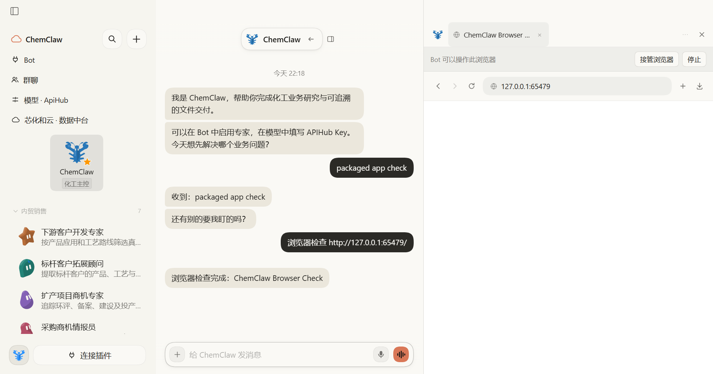

# 浏览器登录状态导入与用户下载

Issue #44，属于 #25。采用 Apache-2.0 上游正式 main `de55888a93983fc51c94f7d22bc94b4f8293205d` 的 Cookie 解析、暂存、已安装浏览器来源、导入界面和下载另存为模块，适配 ChemClaw 的 IPC、Bot 原生分区和安全边界。

用户在 Bot 浏览器工具栏选择导入来源；文件或指定浏览器配置先解析成只含域名、名称、数量和警告的预览，用户确认后才写入当前 Bot 的持久化分区。值仅留在主进程暂存，不进入页面、模型或日志；待确认集合有期限、数量上限和一次性消费语义。离开页面或取消不导入。来源被浏览器锁定时明确说明，只有用户选择关闭并导入后才关闭来源浏览器；系统绑定加密不支持时建议导出 Cookie 文件或手动登录，不绕过加密保护。

普通应用窗口下载使用系统另存为，取消即取消下载。Bot 自动下载继续走现有审批和工作目录边界。仅 ChemClaw 的应用页面可调用原生导入桥接，网页 guest 不获得 IPC。官方 DSH Desktop 若未提供导入桥接则不显示假入口。

测试使用临时合成浏览器配置和 Cookie，覆盖解析、过期/取消、预览不含值、按 Bot 隔离、文件错误、源锁定提示与下载来源识别。不访问用户真实浏览器数据库。保留侧聊和接管功能；生成客户端、单元测试、lint、实际 Electron 界面与原生浏览器检查通过后提交，整批就绪前不合并 main 或发版。

## 验证记录

- Cookie/来源/下载回归 26 项；桌面完整 142 项通过。原生写入错误只返回固定说明，避免异常字符串包含 Cookie 值。
- 插件完整 1146 通过、1 项既有 Windows 跳过；新增浏览器界面回归同时渲染导入和接管控件。
- 真实 Electron 原生浏览器检查：合成登录态只进入指定 Bot 分区、待导入集合一次性消费；原有导航、提交审批、上传下载、持久化、跨 Bot 隔离与接管全部通过。
- 同一源码应用检查：导入桥接与工具栏、浏览器控制、侧聊、布局、触屏、群图表和文件预览通过。首次移植遗漏的接管状态在实际界面测试中被发现并修复，回归已覆盖。
- 生成客户端检查、lint（仅既有警告）、diff 检查通过。未测试用户真实浏览器凭据，也不宣称已验证每个浏览器版本的系统绑定加密。

