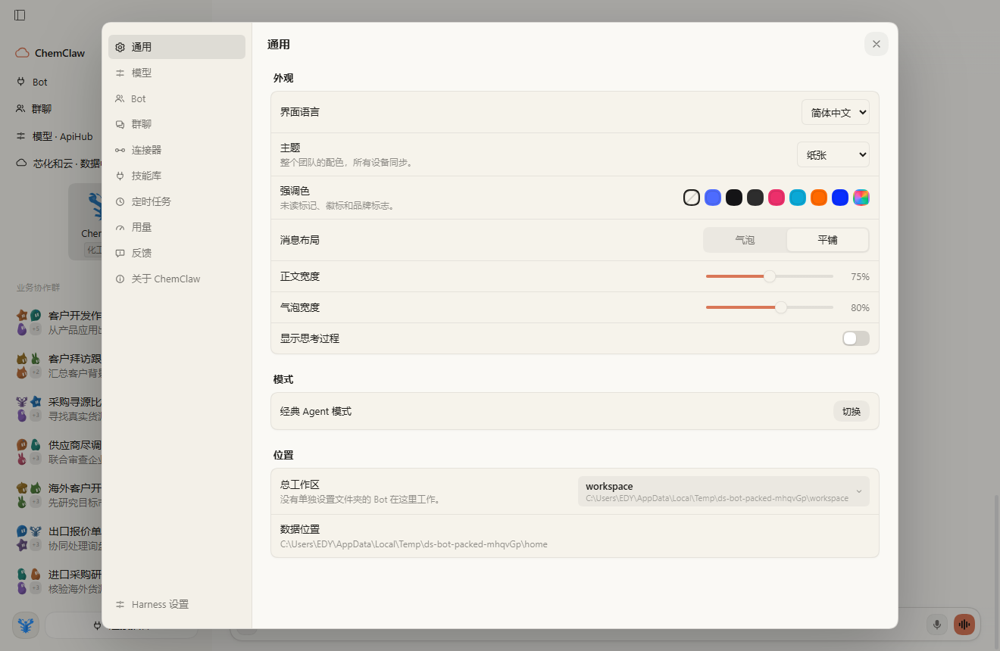
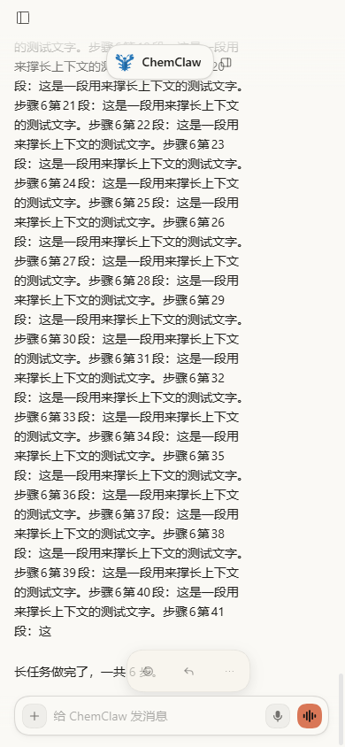

# 聊天布局与触屏

- 日期：2026-10-27；Issue #28；上游基准 de55888a。
- 属于 #25 整批功能；依赖侧聊 #27 和浏览器 #24，全部就绪前不合并 main。

## 行为

通用设置支持气泡和平铺；气泡宽度默认 80%，平铺正文宽度默认 100%，均可在 50–100% 之间调整。设置随团队保存，本机缓存避免首次闪烁；拖动停止 350ms 或关闭设置时保存。思考过程默认隐藏，可显式开启；隐藏思考时活动行仍持续展示，工具执行不因先前输出正文而消失。

触屏点击消息打开复制、引用等操作，保留文件和代码自己的点击行为，点击外部关闭。按钮触摸目标 44px，菜单跟随可视视口变化；窄屏设置导航横排、内容可滚动，输入不触发 iOS 放大，并考虑安全区域。

保留 ChemClaw 工作区切换按钮、中文技能名称、文件路径修复和群聊流式回复。历史 /btw 仅展示既有记录；新的提问通过 /side。工作目录切换时显示明确进度。账号插件提供公开退出操作且已登录时，账号菜单展示退出和确认，不修改 DSH。

## 验证

单测覆盖偏好验证/默认值、布局宽度、回复标题、历史定位和活动行。真实 Electron 源码旅程切换平铺、修改宽度并验证保存，再以 390px 触屏打开消息操作；同时回归侧聊、浏览器、文件预览。mock smoke 使用独立测试 home。

验收记录：完整插件测试 1115 通过、1 个 Windows 限制跳过；lint 和生成文件检查通过；mock smoke 51/51；真实 Electron 完整旅程通过。并发运行 UI 时一次既有工作目录测试超过 2 秒等待，单独复测 31 通过、1 跳过，无 UI 负载完整复测全通过。修复了侧栏加载过程中 ComposerPlus 条件 return 之后调用 hook 的崩溃。

