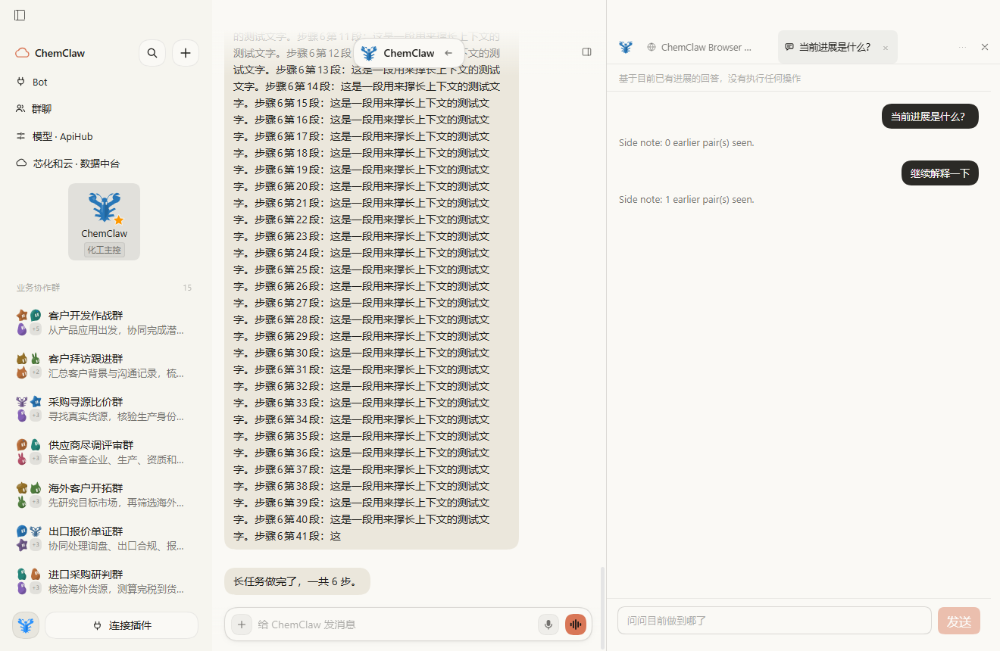

# 不打断主任务的侧聊

- 日期：2026-10-27
- 相关：#26；上游功能对齐批次 #25。
- 来源：Fei2411/DS-Bot `de55888a93983fc51c94f7d22bc94b4f8293205d`，Apache-2.0。

## 已定的行为

Bot 私聊提供「侧聊」菜单和 `/side 问题`。侧聊在 Bot 详情、浏览器共用的右侧面板中
作为独立标签打开，不需要桌面浏览器桥接，DSH Web 也可使用。

每次提问读取主对话当前已提交的消息快照，附带该侧聊已完成的问答。请求沿用主对话
的模型和参数，单独记录用量；未完成的工具调用与不完整结果不进入快照。
不向主 Session 追加消息，不取消、排队或改变主任务，不派发任何工具。
模型试图调用工具时仅重试一次，再失败则明确提示，不执行工具。

侧聊支持多标签、追问、取消当前回答、关闭标签。关闭面板保留历史，关闭侧聊标签
删除该侧聊。主对话换段后仍读取新的当前段。群聊不提供该入口，拒绝空问题和附件，
拒绝时保留输入。中文菜单显示中文名称与用途，稳定命令仍为 `/side`。

问答存放在插件专属 `side/<botId>.json`，不扩大每次整体保存的 state.json。
仅拥有写锁的 Host 可修改；重启留下的回答中条目显示失败，取消与迟到结果不能互相覆盖。
不覆盖无法读取的侧聊文件。删除 Bot、关闭侧聊和卸载插件会停止相关旁路请求。

保留 ChemClaw 的浏览器审批、接管和隐藏截图修复，以及文件预览与工作区切换。
侧聊视图与主任务可同时工作；移动端使用覆盖面板，保持正文可读。

## 验证

移植上游侧聊与面板测试，补充损坏文件和保存失败的保护测试。用隔离 mock 主任务
验证侧聊期间主任务继续、主 Session 不出现侧聊问答、追问和取消可用。
运行插件完整测试、生成客户端检查、lint、原有 smoke 与桌面端检查。
功能批次完成前不合并 PR，不创建发布标签。

## 实测记录

完整桌面应用通过：主对话执行 6 步 mock 长任务时，`/side` 启动侧聊，随后追问
能读取前一组侧聊问答；主任务正常完成。原有浏览器接管、文件预览与本机打开检查
也通过。所有数据来自隔离测试。

插件完整测试 1094 通过、1 项 Windows 平台跳过；原有 mock smoke 51/51 通过；
客户端一致性、样式/中文完整性和 lint 检查通过。
