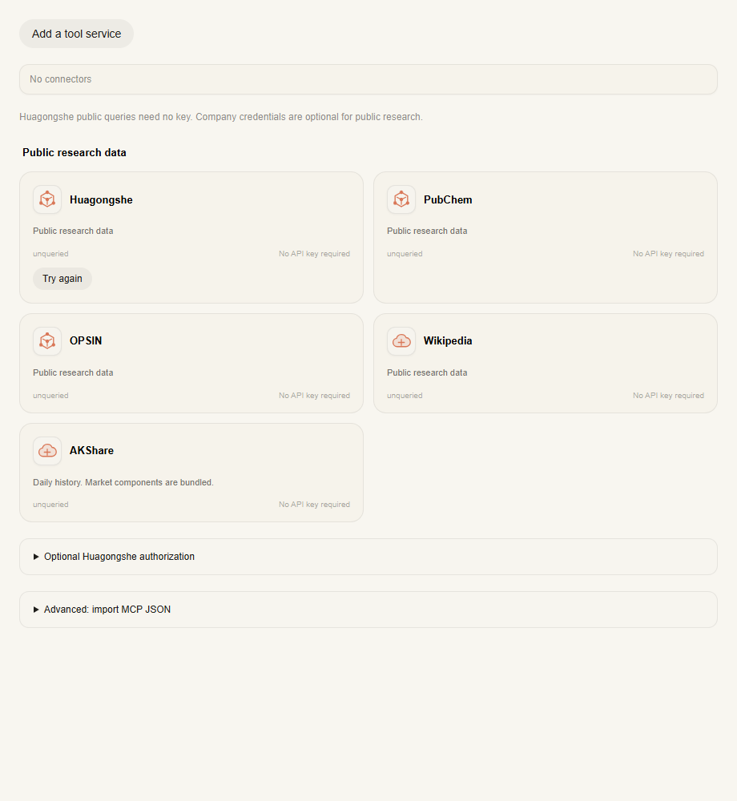

# 随包提供行情运行环境

用户不应安装 Python、理解依赖，或为了查询期货在设置里修复环境。用户网络不稳定，
发布版也不应在首次启动时再下载行情组件。

发布流水线在 Windows x64、macOS arm64/x64、Linux x64 原生构建机上准备独立的
Python 3.12 与 AKShare 1.17.74 及其必要依赖。归档保留上游许可和包元数据，记录
平台、requirements 指纹、SHA-256、压缩与解压体积，并在第二个目录验证可搬迁性。
插件发布包包含四个平台归档；桌面包只包含本平台归档。桌面打包前检查归档，缺失
时在构建机准备。构建缓存不进入发行包。

插件首次启用时从本地归档校验、解包到自己的 runtime/python。子进程使用公开的
插件资源及自有目录；ASAR 中的归档与脚本先写到自有目录，不读取或修改 DSH 安装。
现有环境与归档一致时只检查导入，不重复解包。损坏时从本地恢复，替换失败则还原
旧环境。退出会取消未完成的安装与子进程。源码开发未附归档时才自动下载受管
Python 和行情依赖；下载的 uv 固定版本并校验各平台摘要，不依赖系统 Python。

行情库的 pandas、NumPy 等必要依赖保留。额外的 RDKit、NetworkX、SymPy、SciPy、
Statsmodels、Matplotlib、Seaborn 不默认安装；它们用于本地分子分析、网络分析、
公式计算、统计检验/建模与科学绘图，化工社、PubChem HTTP API 不依赖整套科学库。
本次不删除科学分析技能，额外库只在明确需要时另行处理。普通文件交付与内联图表
继续使用已随包提供的 JavaScript 能力。

删除连接器页的分析运行环境卡片、安装/检查按钮和开启交互预览按钮。交互预览沿用
宿主偏好，独立应用继续使用既定默认值，不借删除按钮修改官方 DSH 的全局偏好。
行情查询仍需联网访问数据源，内置运行环境不代表离线获得最新报价。

验证包含环境安装合并、缓存复用、损坏恢复、版本更新、可选科学库失败隔离、下载
失败与冷却重试、进程取消、归档校验、无网络本地解包、实际 Windows 目录搬迁、
插件打包清单、完整单测/构建/lint 以及独立 mock DSH smoke。

Windows x64 本地验收：行情归档 70.7 MiB，解包环境 216.1 MiB；完整科学环境
对照样本压缩 198.2 MiB、解包 527.3 MiB，均不含下载缓存与应用本体。发布版会
同时保留安装资源中的压缩归档及自有数据目录中的运行环境，因此行情部分合计
约 286.8 MiB。四平台通用插件的总体积要由各原生构建结果汇总，不能把单平台
归档大小当作整个插件大小。

本地已通过禁用环境下载且排除系统 Python 的首次解包、第二次复用验证；使用
该环境的 M0 查询返回截至 2026-10-29 的 16 个日频观测。独立 main 工作区插件
单测 1295 通过、1 项平台跳过；应用测试 205 通过、1 项平台跳过；51 步 mock
smoke 全部通过；构建、生成物
检查、lint（保留既有警告）、打包清单和 Chromium 界面检查通过。未生成新 exe，
macOS/Linux 归档尚待原生 CI 构建验证。

