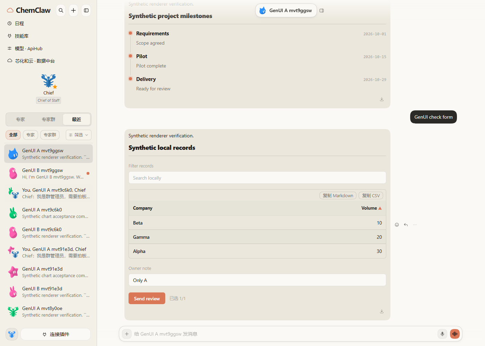
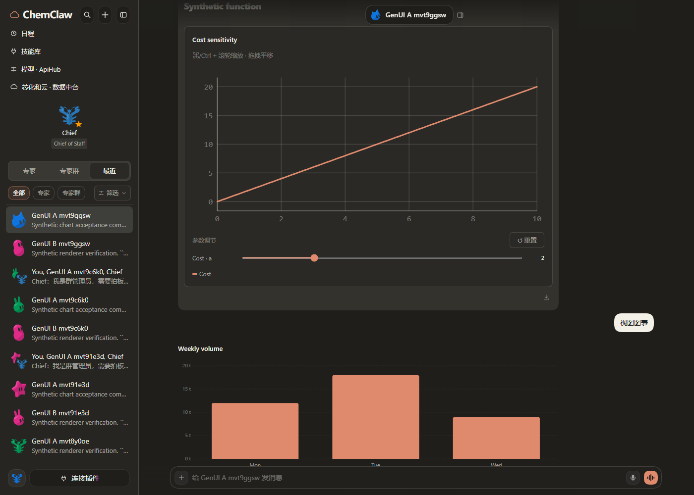
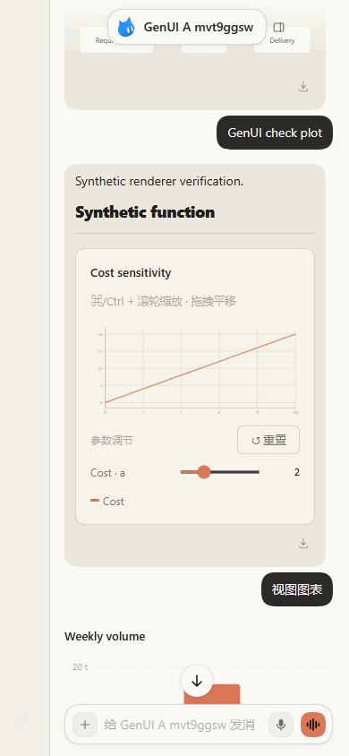
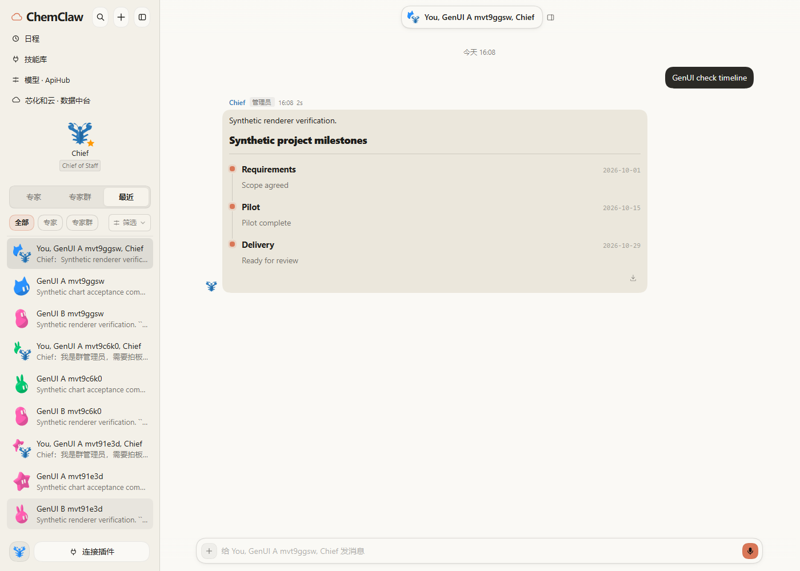
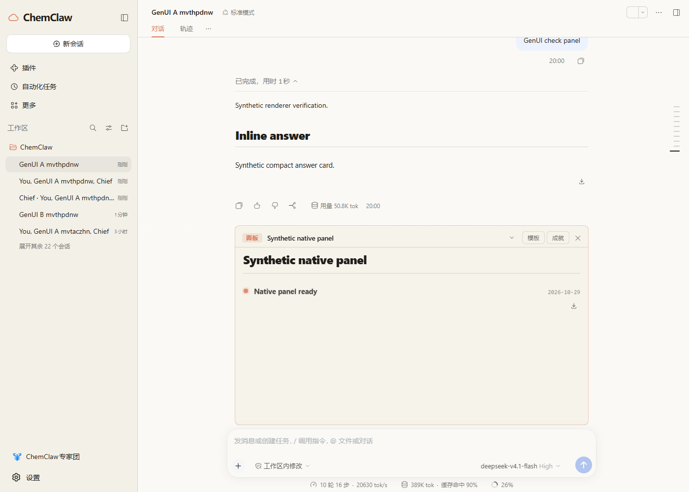
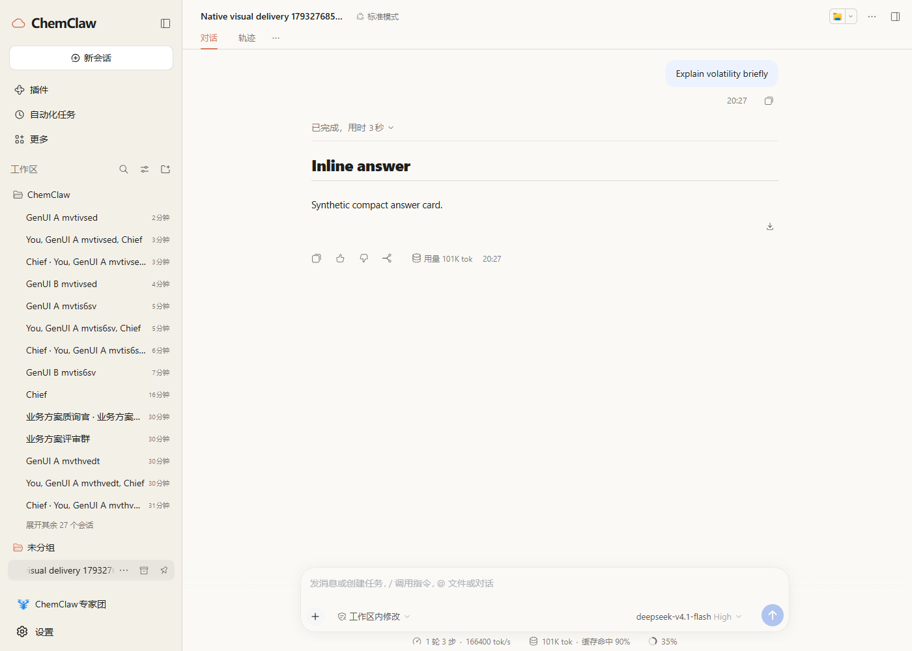

# GenUI 插件组合与自动选用

用户要求内置完整 GenUI 插件，保留已有图表、默认主题与快速本地交互。
这是对七种高级图表接入范围的明确修正，不能把组件子集称为完整插件。

## 组合

固定依赖 MIT 的 @changfenhuang/dsh-genui 0.15.0，使用公开 DSH bundle patch
加载其正式 host/client、校验、技能、组件、资源与原生会话 dock。
不复制或删减上游组件，不修改 DSH，不通过用户私有 profile 安装或测试。

原有 show_view 及七种 chart 继续兼容。GenUI 正文使用 dsh-ui 围栏，
关闭其可选 render_ui 工具渠道，避免同一内容同时产生工具卡与面板。
两种协议只由各自渲染器处理，不以 DOM 猜测或伪造 DSH 消息身份。

## 会话适配

通过 GenUI 正式 genuiSidechat service contract 提供 ChemClaw 结算后的
assistant Markdown surface。source/thread/event/block/fence 稳定身份隔离状态，
回调通过 ChemClaw send 路由进入所属私聊或群聊，卸载后拒绝旧操作。
流式行保留 marker，避免上游主会话扫描器误认。群 Bot 讨论继续不要求视图。
适配器文档明确 panel:true 不属于该 surface 能力：原生会话 dock 单独验收，
不让一个不可见的 panel 消息成为唯一交付；需要时明确提供正文等价视图。

## 自动选用与主题

旧的数值趋势和简单比较仍优先 show_view。时间轴、事件序列、流程/甘特、
分布/网络、复杂筛选表格、函数曲线、媒体、表单等选用 GenUI 原生组件。
同步系统提示和交付技能，查询能力时以当前插件清单为准，不沿用历史回答；
不要求用户知道组件名，不重复展示同一份数据，不为出图补造缺口。

将公开 --dsw-* 颜色、状态、边框、字体映射到 --bt-*，限定于 ChemClaw
surface 与其原生 dock。重型引擎由上游按需加载，本地筛选/排序/滑块不调用模型。

## 每个回答的全局交付

不以基差、行情或数值问题为触发条件：每个面向用户的最终回答默认提供合适的
正文组件，概念解释和简短确认使用紧凑文字卡片，不凭空增加数值。
全局系统提示只注入一次，独立于技能模板，因此新导入的技能无需逐个修改。
旧 show_view 优先；更复杂的关系由完整 GenUI 承担。报告文件不能代替正文视图。

通过公开 agent/turn-stopping 事件检查本回合的正式 assistant 正文和成功的
show_view 交付；仅缺少视图时 steer 一次，只补视图、不重复研究或外部操作。
正常首遍交付增加零次补做请求，漏图最多增加一次；无法承诺真实模型百分之百遵从。
明确纯文字请求、取消、子代理、群中继、隐藏委派和未回答的交互卡不触发补做。
已有坏围栏交给上游自己的校验修复，避免两个模块同时纠错。
热重载在首个实时事件前恢复本回合历史，保留已完成视图、纯文字偏好与补做预算。
传统 Agent 使用 GenUI；show_view 的 Bot 权限保持原设计。

## 验证

固定包包含完整上游组件与许可证；双插件实际 DSH 页面检查时间轴、
图表、排序筛选、表单、本地交互、动作所属会话、两会话相同内容隔离、
刷新状态、插件延迟到达/卸载、原有 SVG/高级图表共存、主题/暗色/窄屏。
mock 只能检查协议和调用次数，不能证明真实模型自动选图率或真实首字速度。

## 本次验收记录

- DSH 0.2.1-rc.3 + 原版 GenUI 0.15.0 + ChemClaw，使用独立 mock profile。
- 全量单测 1304 项：1303 通过，1 项既有 Windows 文件名跳过；构建一致性与 lint 通过。
- 全局交付版本完整 mock smoke 51 步通过；实际 link 源码目录的相关 34 项测试通过。
- 真实页面验证 timeline、Mermaid 流程、函数图、表格本地筛选/排序、两 Bot
  相同表单的状态隔离与刷新恢复、私聊提交路由、群聊时间轴与表单提交/刷新。
- 原有 SVG、高级桑基图和 GenUI 同一会话共存；本地筛选/排序没有前台模型请求。
  后台记忆整理可能独立调用模型，验收计数将它与控件动作分开。
- 普通概念回答不指定图表，实际缺图检查补出正文卡片，只增加一次补做；
  首遍已有时间轴只使用一次前台请求，缺图检查不增加调用。
- 传统 Agent 界面的原生 GenUI 面板单独验证通过，截图见下。
- 通过 DSH 公开 sessionController 创建独立普通根会话，面向真人的概念回答
  自动得到正文 GenUI 卡片；只有一次缺图补做，不依赖 Bot 身份或私聊状态。
  群聊中的真人普通提问也验证自动卡片；内部 Bot 委派跳过由单测覆盖。
- Paper、真实系统暗色切换、390px 窄屏截图如下，窄屏滑块无卡片外溢。
- 同步到实际 link 源码目录，两个目录的客户端都由各自源码构建并通过一致性检查；
  本轮同步范围之外 88 个已有文件或目录的校验值不变。已有 link 安装仍需重新应用 bundle
  依赖配置再重启，源码构建不能替代 profile 的插件依赖安装。

